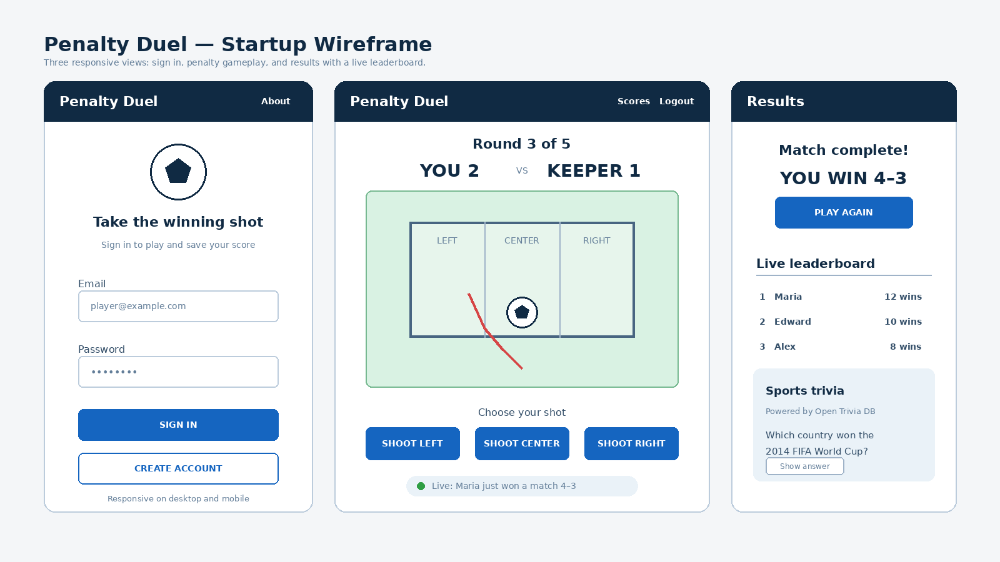
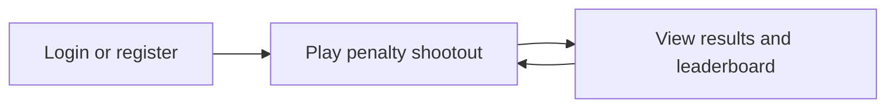

# Penalty Duel

[My Notes](notes.md)

Penalty Duel is an online soccer penalty shootout game. Players choose to shoot left, center, or right and try to beat the goalkeeper. Players will be able to compete, save their scores, and view a live leaderboard.

This project is being developed for BYU CS 260.

### Elevator pitch

Penalty Duel turns the excitement of a soccer shootout into a quick online competition. Players choose where to shoot, challenge the goalkeeper or another player, and climb the live leaderboard as results update instantly. Whether you have a minute between classes or want to compete with friends, every kick creates a simple, fast, and replayable battle for bragging rights.

### Design

The wireframe shows the three main views of the application:

- **Login view** - Players can create an account or sign in to save their progress.
- **Game view** - Players can see the score, choose a shooting direction, and receive the result of each penalty kick.
- **Results view** - Players can see the final score, play again, view the live leaderboard, and answer a sports trivia question.

### Key features

- Secure account registration and login.
- Five-round penalty shootouts with left, center, and right shooting options.
- Immediate visual feedback showing whether each shot was scored or saved.
- Single-player matches against the computer and online matches against another player.
- Player statistics including total wins, losses, scores, and best winning streak.
- A live leaderboard and activity feed that update when other players finish matches.
- A sports trivia question provided by the Open Trivia DB API after each match.
- A responsive interface that works on desktop and mobile screens.

### Technologies

I am going to use the required technologies in the following ways.

- **HTML** - Provides the structure for the login, game, results, leaderboard, trivia, and navigation views.
- **CSS** - Creates a responsive soccer-themed layout for desktop and mobile screens and provides animations for shots, goals, and saves.
- **React** - Provides reusable components for login, gameplay, scoring, the leaderboard, and trivia. React Router moves users between views, and React state updates the score and game status after each shot.
- **Service** - A Node.js and Express backend provides endpoints to register, log in, log out, save match results, and retrieve player statistics and leaderboard scores.
- **Database/Login** - MongoDB securely stores user accounts, hashed passwords, authentication tokens, and completed match results.
- **WebSocket** - The server will send real-time opponent actions, completed-match notifications, activity feed messages, and leaderboard updates to connected players.

## 🚀 Specification Deliverable

For this deliverable I did the following:

- [x] **Prerequisites** - I created the startup repository and used separate Git commits to document each completed part of the specification.
- [x] **Proper use of Markdown** - I organized the README with headings, bullet lists, links, an embedded image, and a Mermaid navigation diagram.
- [x] **Elevator pitch** - I added a concise elevator pitch explaining the purpose, audience, and value of Penalty Duel.
- [x] **Key features** - I documented authentication, penalty gameplay, scoring, player statistics, live updates, sports trivia, and responsive design.
- [x] **Technology descriptions** - I explained how the application will use HTML, CSS, React, Node.js and Express, MongoDB, the Open Trivia DB API, and WebSocket.
- [x] **Design sketches** - I added an embedded wireframe showing the login, gameplay, and results views, along with a navigation flow diagram.

## 🚀 AWS deliverable

For this deliverable I did the following:

- [x] **Rented EC2 server** - I created a `t3.nano` EC2 instance using the Web Programming 260 Server v8 AMI and verified that it is accessible.
- [x] **Leased domain name** - I registered `edwardgm260.click` through Amazon Route 53 and configured DNS records that point to my EC2 server.
- [x] **Server accessible** - I configured Caddy and verified that Penalty Duel is available through HTTPS at [startup.edwardgm260.click](https://startup.edwardgm260.click).

## 🚀 HTML deliverable

For this deliverable I did the following:

- [x] **Prerequisites** - I deployed Simon, included my GitHub link, and made Git commits throughout the work.
- [x] **HTML pages** - I created `index.html`, `play.html`, `scores.html`, and `about.html`.
- [x] **Proper HTML element usage** - I used semantic elements including `header`, `nav`, `main`, `section`, `footer`, forms, tables, and lists.
- [x] **Links** - I added navigation links between all pages and a link to my GitHub repository.
- [x] **Text** - I included descriptions, instructions, match information, scores, and player statistics.
- [x] **3rd party API placeholder** - The About page contains a placeholder for stadium weather information.
- [x] **Images** - The Home and About pages display an image placeholder with descriptive alternative text.
- [x] **Login placeholder** - The Home page contains email and password fields with Login and Create Account buttons.
- [x] **DB data placeholder** - The Scores page contains a leaderboard and player statistics that will come from the database.
- [x] **WebSocket placeholder** - The Play page contains a section for live match updates from another player.

## 🚀 CSS deliverable

For this deliverable I did the following:

- [x] **Prerequisites** - I deployed Simon, included my GitHub repository link, and made Git commits throughout the work.
- [x] **Visually appealing colors and layout** - I created a soccer-themed design using green, yellow, navy, and white. I also used cards, spacing, shadows, and responsive tables to prevent elements from overflowing.
- [x] **Use of a CSS framework** - I used Bootstrap for buttons, tables, form controls, responsive containers, and other components.
- [x] **All visual elements styled using CSS** - I styled the header, navigation, footer, forms, buttons, tables, game panels, leaderboard, statistics, and About page.
- [x] **Responsive to window resizing** - I used Flexbox, CSS Grid, and media queries so the pages adjust to desktop, tablet, and mobile screen sizes.
- [x] **Use of an imported font** - I imported and used the Montserrat font from Google Fonts.
- [x] **Different types of selectors** - I used element, class, ID, and pseudo-class selectors such as `:hover` and `:focus-visible`.

## 🚀 React part 1: Routing deliverable

For this deliverable I did the following:

- [x] **Prerequisites** - I deployed Simon, included my GitHub repository link, and made more than ten meaningful Git commits throughout the React conversion.
- [x] **Bundled using Vite** - I configured Vite to build and run the application, added development and production scripts, and verified that the production build completes successfully.
- [x] **Components** - I converted the Home, Play, Scores, and About pages into reusable React components.
- [x] **Router** - I used React Router with `BrowserRouter`, `Routes`, `Route`, and `NavLink` to navigate between the Home, Play, Scores, and About views without reloading the page.

## 🚀 React part 2: Reactivity deliverable

For this deliverable I did the following:

- [x] **Prerequisites** - I deployed Simon, included the GitHub repository link, and made numerous meaningful Git commits while developing the React application.
- [x] **All functionality implemented or mocked out** - I implemented mocked account creation, login, logout, and browser session persistence using local storage. I created an interactive five-round penalty match with a simulated opponent, live match updates, match results, saved player statistics, recent match history, a simulated leaderboard, and simulated third-party stadium weather data.
- [x] **Hooks** - I used React hooks throughout the application. `useState` manages authentication, gameplay, scores, messages, loading indicators, weather, and leaderboard data. `useEffect` simulates opponent events, database loading, and third-party weather requests. `useRef` prevents completed matches from being saved more than once.

## 🚀 Service deliverable

For this deliverable I did the following:

- [x] **Prerequisites** - I deployed Simon, included my GitHub repository link, and made meaningful Git commits. Penalty Duel is deployed at [startup.edwardgm260.click](https://startup.edwardgm260.click).
- [x] **Node.js/Express HTTP service** - I created an Express service that runs on port 4000 and is managed in production with PM2.
- [x] **Static middleware for frontend** - Express serves the Vite production files from the `public` directory.
- [x] **Calls to third-party endpoints** - The About page loads current Provo weather conditions from the Open-Meteo service.
- [x] **Backend service endpoints** - I added endpoints for health checks, authentication, matches, player statistics, and the leaderboard.
- [x] **Frontend calls service endpoints** - The React frontend uses the service for authentication, saving matches, loading match history, and displaying scores.
- [x] **Registration, login, logout, and restricted endpoint** - Users can create accounts, log in, log out, and access protected match-saving functionality through an HTTP-only cookie.
- [x] **Uses BCrypt to hash passwords** - Passwords are hashed with BCrypt before user records are stored in MongoDB.

## 🚀 DB deliverable

For this deliverable I did the following:

- [x] **Prerequisites** - I deployed Simon, included my GitHub repository link, and made at least ten meaningful Git commits while completing the database integration.
- [x] **Stores data in MongoDB** - Completed penalty matches are stored in MongoDB Atlas. The Scores page loads recent matches and builds the leaderboard from persistent database records. I verified persistence by restarting the service and confirming that previously saved results remained available.
- [x] **Stores credentials in MongoDB** - User accounts, BCrypt password hashes, and authentication tokens are stored in MongoDB. Authentication uses an HTTP-only cookie, and database credentials are kept in the Git-ignored `service/dbConfig.json` file.

### Database implementation

Penalty Duel uses MongoDB Atlas with separate `user` and `match` collections. Unique and lookup indexes are created for email addresses, authentication tokens, match dates, and player emails.

The service provides the following database-backed endpoints:

- `GET /api/health` verifies both the service and MongoDB connection.
- `POST /api/auth/create` creates and stores a new user.
- `POST /api/auth/login` authenticates an existing user.
- `DELETE /api/auth/logout` removes the current authentication token.
- `POST /api/matches` stores a completed match for the authenticated player.
- `GET /api/matches` returns the 20 most recent matches.
- `GET /api/scores` builds and returns the leaderboard.

## 🚀 WebSocket deliverable

For this deliverable I did the following:

- [ ] **Prerequisites** - I have not completed this deliverable yet.
- [ ] **Backend listens for WebSocket connection** - I have not completed this part of the deliverable.
- [ ] **Frontend makes WebSocket connection** - I have not completed this part of the deliverable.
- [ ] **Data sent over WebSocket connection** - I have not completed this part of the deliverable.
- [ ] **WebSocket data displayed** - I have not completed this part of the deliverable.
- [ ] **Application is fully functional** - I have not completed this part of the deliverable.